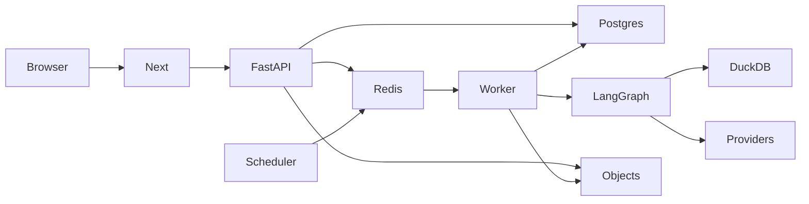

# Architecture

The Next.js App Router hosts the workspace and forwards same-origin API requests. TanStack Query manages responses and cache invalidation. Job views receive server-sent events and poll when the stream is disconnected. Recharts renders persisted results and supports local group and date filters.

FastAPI serves authentication, project resources, imports, cleaning, SQL, saved dashboards, reports, and recurrence definitions. SQLAlchemy and Alembic own metadata persistence. Dataset snapshots are serialized to Parquet with SHA-256 hashes and parent-version links. A private filesystem volume is the local object store. Deployments can use an S3-compatible endpoint and a private bucket.

DuckDB executes validated analytical statements against registered frames in a temporary in-memory database. Pandas and PyArrow handle tabular snapshots. NumPy, SciPy, Statsmodels, and scikit-learn handle statistics, forecasting, and model evaluation. Report generation uses Matplotlib, XlsxWriter, and python-pptx. The API provides GET endpoints for authorized downloads.

PostgreSQL stores job states and the LangGraph checkpoints. Redis provides rate limits and brokers Celery messages. Celery processes workflows, reports, and larger uploads. Beat owns periodic dispatch and recovery. The host filesystem and cloud object store are interchangeable for dataset and report objects.

External providers are optional. The workflow records provider usage when returned by the API and uses local planning when the model is unavailable. Brave search discovery requires a configured key and request approval.
